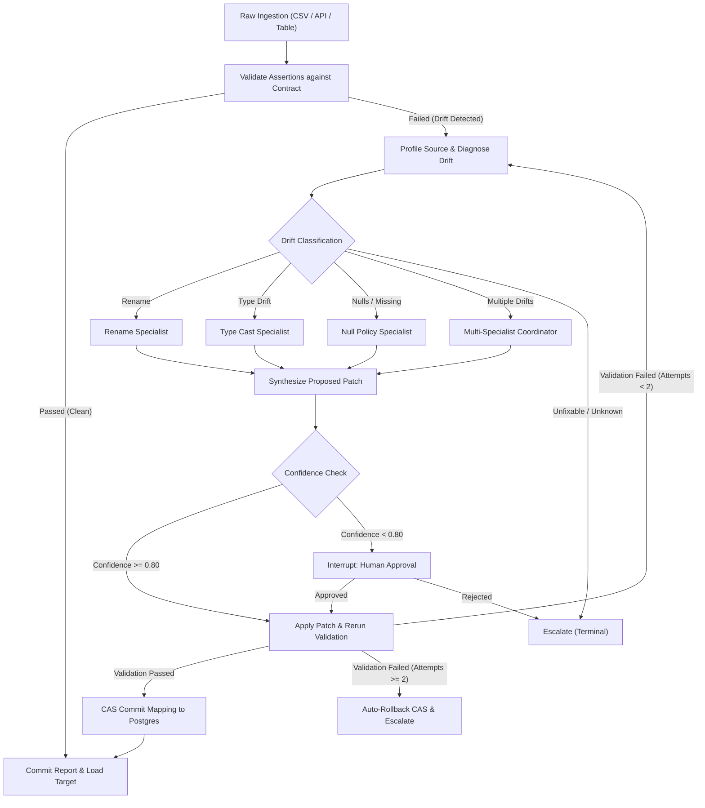

# Self-Healing Data Pipeline: Presentation Playbook & Live Demo Script

> **Target Audience:** Engineering Leads, System Architects, Technical Interviewers, and Stakeholders.  
> **Estimated Duration:** 15–20 minutes (Presentation + Live Demo + Q&A).

---

## 1. Executive Summary & The Problem

### **The Hook (Speaker Notes - 1.5 mins)**
> *"Good morning/afternoon everyone. In modern data platforms, data contracts break silently every single day. A third-party provider renames a column from `customer_id` to `account_id`; an upstream engineer changes a numeric price into a formatted string like `$49.99`; or unexpected nulls creep into non-nullable fields. 
> 
> What usually happens? The overnight ETL batch crashes at 3:00 AM. A data engineer is paged, spends three hours debugging raw files, pushes an ad-hoc fix, re-runs the pipeline manually, and prays nothing else broke.
> 
> Today, I’m presenting **Self-Healing Data Pipeline**: an autonomous, resilient ingestion platform built on **LangGraph, FastAPI, Neon Serverless Postgres, and React**. Instead of crashing on contract drift, the pipeline diagnoses the failure using specialized LLM agents, proposes bounded declarative schema patches, validates fixes through self-healing cycles, halts for human approval on ambiguous drift, and preserves complete CAS transactional auditability."*

---

## 2. Core Value Proposition (3 Key Pillars)

1. **Autonomous Recovery without Code Changes:**
   * Drift is healed via declarative configuration patches (`rename`, `casts`, `fill_na`, `dates`), **never arbitrary Python or SQL code**. The pipeline transforms data dynamically according to strictly validated Pydantic schemas.
2. **Deterministic Safety & CAS Rollbacks:**
   * Patches are versioned in an append-only ledger in Postgres. Concurrent runs and patch applications use PostgreSQL advisory locks (`pg_advisory_xact_lock`) with Compare-And-Swap (CAS) guarantees. If an applied patch fails subsequent validation, it rolls back automatically to the previous parent state.
3. **Human-in-the-Loop (HITL) Gateways:**
   * Clear, high-confidence patches (confidence $\ge 0.80$) auto-apply. Ambiguous drift (confidence $< 0.80$, like ambiguous renames) triggers a LangGraph `interrupt()`, durably serializing graph state to Neon Postgres until a human operator approves or rejects it in the UI.

---

## 3. High-Level Architecture Overview



---

## 4. Step-by-Step Live Demo Script

### **Scene 1: Data Contracts & Registry (2 mins)**
* **Action:** Navigate to **Data Contracts** (`/contracts`).
* **Display:** Show the active contracts list (`default`, `compact`, `ecommerce_v1`).
* **Speaker Script:**
  > *"Every pipeline run is strictly scoped to a Data Contract. Contracts define expected column names, data types, minimum row counts, and domain constraints.
  > Notice that we support dynamic contract registration. An engineer or client can upload a new contract YAML or JSON document here. It is validated, versioned in Postgres, and loaded into an in-memory registry overlay without restarting any backend pods."*
* **Action:** Show the version history and column previews for `ecommerce_v1`.

---

### **Scene 2: Clean Ingestion (1.5 mins)**
* **Action:** Navigate to **Data Ingestion** (`/ingestion`).
* **Select Contract:** `ecommerce_v1`.
* **Upload:** `01_ecommerce_clean_valid.csv`.
* **Display:** Show the instant 15-row data preview with column type badges.
* **Speaker Script:**
  > *"First, let's observe the happy path. I'll upload a clean dataset containing order IDs, customer IDs, categories, amounts, and statuses. The backend enforces a 5 MB / 5,000-row upload limit for edge protection and captures an immutable source snapshot in Postgres with SHA-256 verification.
  > Let’s trigger the run."*
* **Action:** Click **Run pipeline**. Wait ~3–4 seconds.
* **Result:** Navigates to `/runs/<run_id>`. Status shows **Clean** (Green badge), 0 attempts, assertion bars 100% green.

---

### **Scene 3: Autonomous Self-Healing (Column Rename) (3 mins)**
* **Action:** Return to `/ingestion`. Contract: `ecommerce_v1`.
* **Upload:** `02_ecommerce_renamed_column.csv`.
* **Speaker Script:**
  > *"Now let's simulate an upstream vendor breaking change. In this file, the column `amount` was renamed to `total_amount`. Normally, the schema validation would crash immediately. Watch what happens here."*
* **Action:** Click **Run pipeline**.
* **Result on Run Detail:**
  1. Graph canvas animates through `diagnose` $\rightarrow$ `spec_rename` $\rightarrow$ `apply_patch` $\rightarrow$ `rerun_validate` $\rightarrow$ `commit_report`.
  2. Status turns to **Healed** (Blue badge), 1 attempt.
  3. **Schema Diff Component:** Shows `total_amount` detected in source, mapped back to expected contract field `amount`.
  4. **Patch Diff Component:** Displays the declarative patch JSON:
     ```json
     {
       "rename": {
         "total_amount": "amount"
       }
     }
     ```
* **Speaker Script:**
  > *"The pipeline detected the missing column, diagnosed a rename drift, invoked the rename specialist LLM, proposed the exact mapping with high confidence, applied the patch in memory, re-verified that all contract assertions now pass, and committed the patch to the database. Zero human intervention."*

---

### **Scene 4: Human-in-the-Loop Approval (Ambiguous Drift) (3 mins)**
* **Action:** Return to `/ingestion`. Contract: `default`.
* **Upload:** `data/sources/day6_ambiguous_rename.csv`.
* **Speaker Script:**
  > *"What happens when an agent isn't 100% sure? Autonomy without human oversight is dangerous. In `day6_ambiguous_rename.csv`, column `customer_id` has been renamed to `acct_ref`. Is `acct_ref` an account reference, an affiliate ID, or a customer ID? The LLM confidence drops to 0.70, below our 0.80 auto-apply threshold."*
* **Action:** Click **Run pipeline**.
* **Result on Run Detail:**
  1. Status turns to **Awaiting Approval** (Yellow/Amber badge).
  2. The graph pauses at the `human_approval` node.
  3. The **Awaiting human approval** card appears on the right sidebar.
* **Speaker Script:**
  > *"Notice that the pipeline did not blindly patch production, nor did it crash. LangGraph triggered an in-process `interrupt()`, durably serializing the entire graph state into Neon Postgres.
  > Even if the server were rebooted right now, the run state and paused thread survive intact. As a human reviewer, I see the proposed patch, rationale, and confidence score. I can provide an audit note and click **Approve**."*
* **Action:** Type note `"Approved: acct_ref is verified as customer ID"` and click **Approve**.
* **Result:** The graph resumes instantly, re-runs assertions, and turns **Healed**!

---

### **Scene 5: Mapping Ledger & Auditability (2 mins)**
* **Action:** Navigate to **Mapping & Approvals** (`/mapping`).
* **Speaker Script:**
  > *"Every single change made to the pipeline configuration is stored in an immutable, append-only ledger in Postgres. Here on the Mapping page, you see the active schema mapping, followed by the chronological timeline of every patch applied, every human approval or rejection with reviewer notes, and automated rollback events. 
  > This provides complete SOC2/compliance auditability."*

---

### **Scene 6: Analytics & Read-Only Observability (1.5 mins)**
* **Action:** Navigate to **Overview** (`/`).
* **Speaker Script:**
  > *"The executive Overview displays live health analytics: total runs, clean vs healed ratios, confidence score distributions, specialist performance breakdown, and drift classification frequencies. 
  > All queries are checkpointer-backed and performant even across large run volumes."*

---

## 5. Technical Highlights for Deep-Dive Q&A

When asked deep architectural questions, highlight these design decisions:

| Question / Topic | Key Technical Answer |
| :--- | :--- |
| **Why LangGraph?** | Provides stateful, multi-agent cyclic graph execution with native durable checkpointers and pause/resume `interrupt()` primitives. Traditional DAG tools (Airflow/Prefect) are acyclic and cannot easily loop back for re-validation. |
| **How are patches safe?** | Patches are strictly typed Pydantic models. Specialists can only emit keys in their allowed sections (`extra="forbid"`). No arbitrary Python code or raw SQL is ever executed from an LLM. |
| **Concurrency & Race Conditions?** | Patch commits use Postgres advisory transaction locks (`pg_advisory_xact_lock`) with parent version checks (Compare-And-Swap). Conflicting writes fail safely and trigger reconciliation. |
| **Storage Architecture?** | Built on Neon Serverless Postgres. LangGraph checkpointer persists serialized thread state and checkpoints in `checkpoints` and `checkpoint_blobs` tables. Runs survive process crashes. |
| **LLM Performance & Costs?** | Leverages fast inference via Groq (`llama-3.3-70b-versatile`) with tight JSON schema enforcement, achieving 1–3s diagnosis times at minimal cost. |

---

## 6. Closing Statement

> *"In summary, Self-Healing Data Pipeline bridges the gap between fragile static schemas and uncontrolled AI automation. It delivers autonomous recovery for routine drift, strict human oversight for ambiguous cases, and database-level transactional safety at every step. Thank you, and I’m ready for your questions."*
